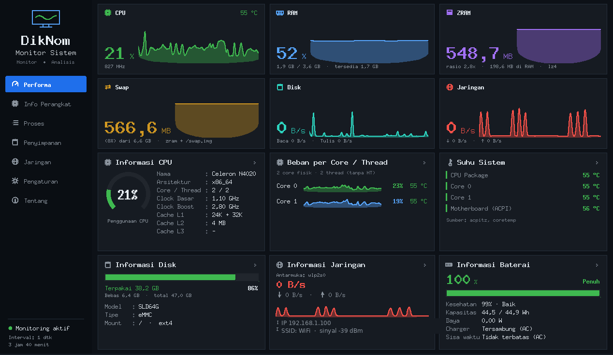
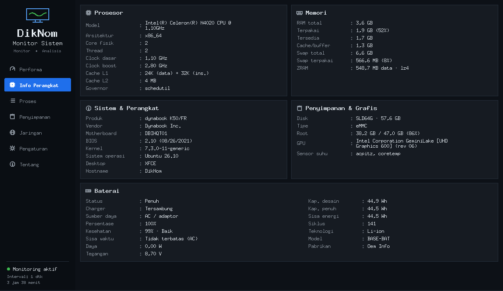
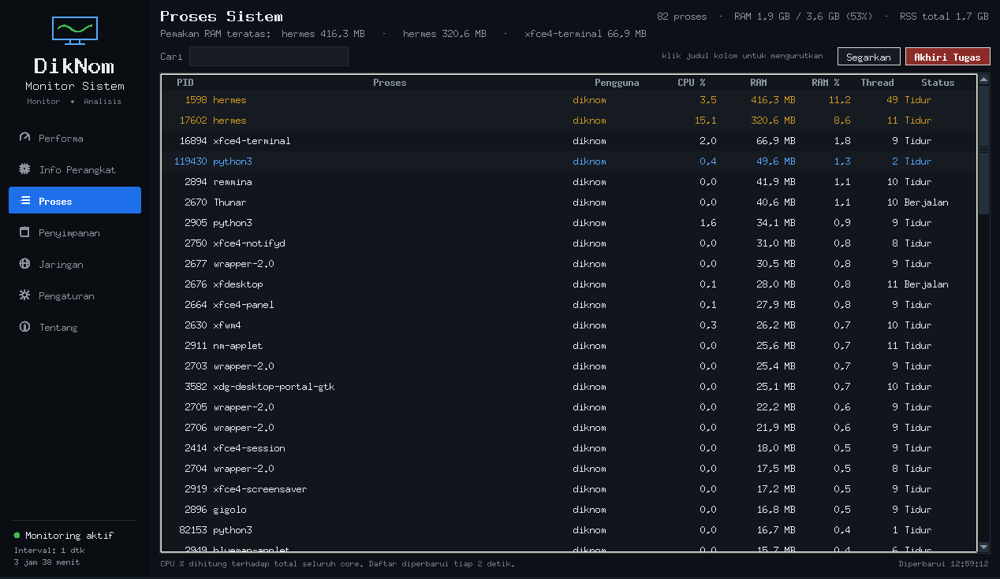

<p align="center">
  
</p>

<h1 align="center">DSM — DikNom System Monitor</h1>

<p align="center">
  <strong>Versi 1.0</strong> · Monitor sistem ringan untuk Linux, Windows, dan macOS<br>
  Dibuat oleh <strong>DikNom</strong>
</p>

<p align="center">
  
  
  
  
</p>

DSM adalah monitor sistem dan task manager ringan dengan antarmuka gelap.
Semua informasi penting — beban CPU per core/thread, suhu, RAM, ZRAM, swap,
disk, jaringan, baterai, dan daftar proses — tersedia dalam satu dashboard
tanpa Electron, server lokal, atau dependensi GUI berat.

Cocok untuk laptop hemat daya, termasuk mesin 2 core/4 GB RAM. Aplikasi
berjalan langsung dengan Python + tkinter + psutil dan tidak memerlukan root
untuk monitoring.

---

## Tangkapan Layar

### Performance
Grafik CPU total dan per core/thread, suhu, RAM/ZRAM/swap, disk, jaringan,
baterai, serta panel informasi CPU, core, dan suhu.



### Hardware Info
Deteksi prosesor, memori, sistem/BIOS, penyimpanan, GPU, dan kartu baterai
lengkap.



### Processes
Daftar proses dengan CPU %, RAM, RAM %, thread, dan status. Bisa dicari,
diurutkan per kolom, dan diakhiri dengan konfirmasi.



> Screenshot diambil dari mesin uji. Alamat IP dan nama Wi-Fi disamarkan.

---

## Fitur

### Performance

- **CPU total** — grafik riwayat penggunaan, frekuensi saat ini, dan suhu
  package bila sensor tersedia.
- **CPU per core/thread** — satu grafik untuk setiap CPU logis, lengkap dengan
  persentase dan suhu per core. Jumlah grafik otomatis menyesuaikan perangkat
  (2 core = 2 grafik; 8 thread = 8 grafik).
- **Informasi CPU** — nama model, arsitektur, core/thread, base clock, boost
  clock, cache L1/L2/L3, dan governor.
- **RAM** — persentase pemakaian, kapasitas terpakai/total, dan memori tersedia.
- **ZRAM** — data terkompresi, rasio kompresi, memori yang dipakai di RAM, dan
  algoritma kompresi.
- **Swap** — pemakaian swap total (ZRAM + file swap).
- **Disk** — pemakaian partisi utama, kecepatan baca/tulis, model, tipe, dan
  mount point.
- **Jaringan** — kecepatan download/upload, grafik trafik, interface, IP, dan
  SSID/sinyal Wi-Fi.
- **Baterai** — persentase, status (penuh/mengisi/memakai baterai), kesehatan,
  kapasitas desain dan penuh, daya, tegangan, siklus, model, pabrikan,
  status charger, sumber AC/baterai, dan perkiraan sisa waktu.
- **Suhu Sistem** — package CPU, setiap core, dan sensor ACPI yang tersedia.

### Hardware Info

- Prosesor: model, arsitektur, core fisik, thread, clock, cache, governor.
- Memori: total, terpakai, tersedia, cache/buffer, swap, dan ZRAM.
- Sistem: produk, vendor, motherboard, BIOS, kernel, OS, desktop, hostname.
- Penyimpanan: model disk, tipe (eMMC/SSD/HDD/NVMe), pemakaian root, dan GPU.
- Baterai: status, charger, sumber daya, persentase, kesehatan, sisa waktu,
  daya, tegangan, kapasitas desain/penuh/tersisa, siklus, teknologi, model,
  dan pabrikan.

Deteksi hardware memakai psutil, lalu fallback sesuai OS:

- **Linux** — `/proc`, `/sys`, DMI, `lspci`, `iw`, dan `nmcli`.
- **Windows** — WMI/PowerShell (`Get-CimInstance`) dan `netsh` untuk Wi-Fi.
- **macOS** — `system_profiler`, `pmset`, dan `diskutil`.

Bagian yang tidak tersedia di perangkat tertentu ditampilkan sebagai `-`,
bukan error. Pada PC desktop tanpa baterai, panel baterai otomatis
disembunyikan.

### Processes

- Kolom PID, nama proses, pengguna, CPU %, RAM, RAM %, thread, dan status.
- Default diurutkan dari pemakai RAM terbesar.
- Klik judul kolom untuk mengurutkan; klik lagi untuk membalik urutan.
- Pencarian berdasarkan nama proses, nama pengguna, atau PID.
- Tombol **Akhiri Tugas** mengirim `SIGTERM` setelah konfirmasi.
  PID 1 dan aplikasi DSM sendiri dilindungi.
- Thread kernel disembunyikan secara default; bisa ditampilkan lewat Settings.
- Sampling proses dilakukan di worker thread dan hanya berjalan saat halaman
  Processes dibuka, supaya hemat CPU.

### Storage, Network, dan Settings

- **Storage** — ringkasan partisi, tabel mount, dan grafik aktivitas disk.
- **Network** — daftar interface, status, IP, MAC, kecepatan link, total
  diterima/dikirim, detail Wi-Fi (SSID, sinyal, frekuensi, bitrate).
- **Settings** — interval pembaruan (1–3 detik), panjang riwayat grafik,
  selalu di atas, sembunyikan thread kernel, ambang suhu, dan bahasa.
- **About** — informasi aplikasi, versi, fitur, dan developer.

### Bahasa

Tiga pilihan bahasa di **Settings → Bahasa**:

| Pilihan | Perilaku |
|---|---|
| **Otomatis (sistem)** | Mengikuti locale sistem; `id_ID` → Indonesia, locale lain → English |
| **Indonesia** | Selalu Bahasa Indonesia |
| **English** | Selalu English |

Perubahan bahasa langsung membangun ulang antarmuka tanpa restart. Format
angka juga mengikuti bahasa: `1.234,5` untuk Indonesia dan `1,234.5` untuk
English. Pilihan disimpan otomatis.

### Ringan dan privat

- Tanpa Electron, tanpa browser, dan tanpa server lokal.
- Perkiraan RAM 35–50 MB; grafik digambar langsung di Canvas tkinter.
- Tidak ada telemetry dan tidak ada koneksi jaringan dari aplikasi.
- Semua data dibaca secara lokal dari psutil/sysfs/perintah sistem.
- Tidak membutuhkan akses root untuk fitur monitoring.

---

## Dukungan Sistem

| Platform | Status | Catatan |
|---|---|---|
| Linux (semua distro) | Utama | Sysfs, DMI, `iw`/`nmcli` bila tersedia |
| Windows 10/11 | Didukung dengan fallback | WMI/PowerShell, `netsh`; sebagian sensor suhu mungkin tidak ada |
| macOS | Didukung dengan fallback | `system_profiler`, `pmset`, `diskutil` |

Pengujian utama dilakukan di **Ubuntu 26.10 + XFCE** pada Dynabook K50/FR
(Intel Celeron N4020, 2 core/2 thread, RAM 4 GB, eMMC 64 GB). Kode untuk
Windows/macOS memakai fallback dan belum diuji seluas Linux.

---

## Kebutuhan

- Python 3.9 atau lebih baru
- tkinter
- [psutil](https://github.com/giampaolo/psutil) 5.9 atau lebih baru
- Linux: sensor `coretemp` (umumnya sudah ada) dan baterai di
  `/sys/class/power_supply/BAT0` bila perangkat memiliki baterai
- Windows/macOS: PowerShell / `system_profiler` tersedia secara bawaan

### Dependensi per distro

| Distro | Perintah |
|---|---|
| Debian / Ubuntu / Linux Mint | `sudo apt install python3-tk python3-psutil` |
| Fedora / RHEL | `sudo dnf install python3-tkinter python3-psutil` |
| Arch / Manjaro | `sudo pacman -S tk python-psutil` |
| openSUSE | `sudo zypper install python3-tk python3-psutil` |
| Alpine | `sudo apk add python3-tkinter py3-psutil` |
| Void Linux | `sudo xbps-install python3-tkinter python3-psutil` |

Kalau tkinter sudah ada tetapi psutil belum:

```bash
python3 -m pip install --user psutil
```

---

## Instalasi

### 1. Clone repository

HTTPS:

```bash
git clone https://github.com/diknom/diknom-system-monitor.git
cd diknom-system-monitor
```

SSH (jika SSH key sudah terpasang di GitHub):

```bash
git clone git@github.com:diknom/diknom-system-monitor.git
cd diknom-system-monitor
```

Belum punya Git? Unduh ZIP dari halaman repo GitHub, ekstrak, lalu buka
terminal di folder tersebut.

### 2. Instal di Linux (satu perintah)

```bash
./install.sh
```

Pemasang akan:

1. Memeriksa Python, tkinter, dan psutil.
2. Mendeteksi package manager distro (`apt`, `dnf`/`yum`, `pacman`, `zypper`,
   `apk`, atau `xbps-install`).
3. Otomatis memasang dependensi yang kurang (bisa meminta password sudo).
4. Memilih interpreter Python yang benar-benar memiliki tkinter + psutil.
5. Memasang aplikasi, ikon, dan menu desktop.

Aplikasi dipasang secara **user-local**; hanya langkah pemasangan dependensi
yang mungkin meminta password sudo:

- `~/.local/bin/diknom-monitor` — wrapper launcher
- `~/.local/share/diknom-monitor/diknom-monitor` — aplikasi
- `~/.local/share/icons/diknom-monitor.png`
- `~/.local/share/applications/diknom-monitor.desktop`

Jalankan:

```bash
diknom-monitor
```

atau cari **DikNom System Monitor** di menu aplikasi.

### Opsi pemasang

| Opsi | Fungsi |
|---|---|
| `./install.sh` | Instal; dependensi kurang dipasang otomatis |
| `./install.sh --no-deps` | Cek dependensi saja, tanpa mengubah sistem |
| `./install.sh --deps` | Paksa pasang dependensi (sama dengan default) |
| `./install.sh --pip` | Pasang psutil lewat `pip --user` bila perlu |
| `./install.sh --system` | Instal ke `/usr/local` (butuh root) |
| `./install.sh --prefix=DIR` | Instal ke lokasi lain |
| `./install.sh --help` | Bantuan |

Kalau `~/.local/bin` belum ada di `PATH`, pemasang akan menampilkan baris
`export PATH=...` yang perlu ditambahkan ke `~/.profile`.

### 3. Menjalankan tanpa instalasi

Linux/macOS:

```bash
python3 diknom-monitor
```

Windows (Command Prompt/PowerShell):

```bat
py -3 -m pip install psutil
py -3 diknom-monitor
```

Instalasi manual di Linux:

```bash
install -Dm755 diknom-monitor ~/.local/bin/diknom-monitor
install -Dm644 assets/icon.png ~/.local/share/icons/diknom-monitor.png
```

> Cara manual menjalankan file aplikasi langsung. Cara `./install.sh`
> lebih disarankan karena membuat wrapper Python yang terverifikasi.

### 4. Copot pemasangan

```bash
./uninstall.sh
```

Untuk instalasi sistem:

```bash
sudo ./uninstall.sh --system
```

Konfigurasi di `~/.config/diknom-monitor` tidak dihapus otomatis.

---

## Cara Pakai

- Gunakan panel kiri untuk berpindah halaman; tidak ada tab bar duplikat.
- **Performance** menampilkan ringkasan seluruh sistem dan baterai.
- **Hardware Info** menampilkan detail perangkat.
- **Processes** menampilkan seluruh proses; klik header untuk sortir.
- **Storage** dan **Network** menyediakan rincian partisi dan interface.
- **Settings** menyimpan perubahan secara otomatis.
- **About** menampilkan versi dan kredit developer.

### Pintasan

| Pintasan | Fungsi |
|---|---|
| `Ctrl+1` … `Ctrl+7` | Pindah halaman |
| `F5` | Segarkan daftar proses |
| `Ctrl+Q` | Keluar |

---

## Pengaturan

Disimpan otomatis di:

```
~/.config/diknom-monitor/config.json
```

| Kunci | Arti |
|---|---|
| `interval` | Interval pembaruan (1–3 detik) |
| `history` | Jumlah titik riwayat grafik |
| `ontop` | Jendela selalu di atas |
| `hide_kernel` | Sembunyikan thread kernel dari daftar proses |
| `temp_warn` | Ambang suhu peringatan (°C) |
| `language` | `auto`, `id`, atau `en` |
| `width`, `height`, `page` | Ukuran jendela dan halaman terakhir |

---

## Struktur Repository

```
diknom-system-monitor/
├── diknom-monitor              # aplikasi utama (Python + tkinter)
├── install.sh                  # pemasang lintas distro
├── uninstall.sh                # pencopot pemasangan
├── requirements.txt            # dependensi Python
├── README.md
├── CHANGELOG.md
├── LICENSE                     # MIT
└── assets/
    ├── icon.png
    └── screenshots/
        ├── performance.png
        ├── hardware.png
        └── processes.png
```

---

## Sumber Data dan Privasi

- CPU, memori, disk, jaringan, proses, dan baterai dasar: **psutil**.
- Suhu: `psutil.sensors_temperatures()` / sensor `coretemp`.
- ZRAM dan baterai rinci: sysfs Linux.
- Hardware, BIOS, dan GPU: sysfs/DMI (Linux), WMI (Windows),
  `system_profiler` (macOS).
- Wi-Fi: `iw`/`nmcli` (Linux), `netsh` (Windows), `system_profiler` (macOS).

DSM tidak mengirim data ke internet, tidak memiliki telemetry, dan tidak
membuka port jaringan. Semua pembacaan dilakukan secara lokal. Beberapa
perintah sistem hanya dijalankan bila tersedia; jika tidak, bagian terkait
ditampilkan sebagai `-`.

---

## Troubleshooting

**`ModuleNotFoundError: No module named 'tkinter'`**
Jalankan `./install.sh --deps`, atau instal paket tkinter sesuai distro pada
tabel di atas.

**`ModuleNotFoundError: No module named 'psutil'`**
Jalankan `./install.sh --deps` atau `python3 -m pip install --user psutil`.

**Menu aplikasi tidak muncul**
Jalankan `update-desktop-database ~/.local/share/applications`, lalu logout
dan login lagi. Pastikan `~/.local/bin` ada di `PATH`.

**Suhu tidak tampil**
Pastikan sensor `coretemp` tersedia. Di VM biasanya sensor suhu tidak
diteruskan. Di Linux, instal `lm-sensors` untuk memeriksa sensor.

**Baterai menampilkan `-`**
Perangkat desktop/VM tidak memiliki baterai, atau driver tidak mengekspos
kapasitas/kesehatan. Persentase dan status charger tetap bisa tampil lewat
psutil.

**Launcher desktop berhenti setelah folder dipindah**
Jalankan ulang `./install.sh` agar wrapper dan path diperbarui.

**Windows terasa lambat saat pertama dibuka**
Pembacaan WMI/PowerShell pertama bisa memakan beberapa detik; setelah itu
data diperbarui dari psutil.

---

## Changelog

Lihat [CHANGELOG.md](CHANGELOG.md) untuk riwayat versi.

## Lisensi

MIT — lihat [LICENSE](LICENSE).

---

<p align="center">
  <strong>DSM (DikNom System Monitor) V1.0</strong><br>
  Developer: <strong>DikNom</strong><br>
  Dibuat untuk membantu memantau sistem dengan ringan.
</p>
